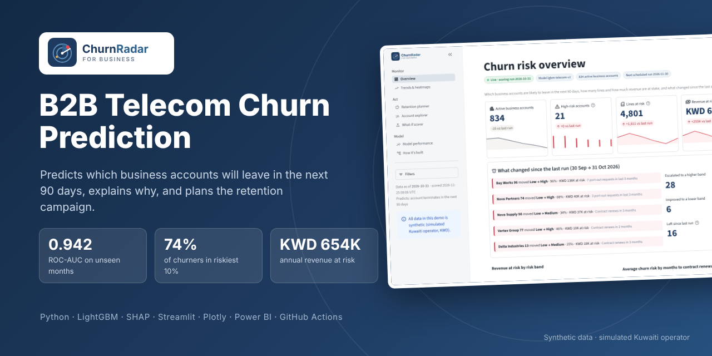
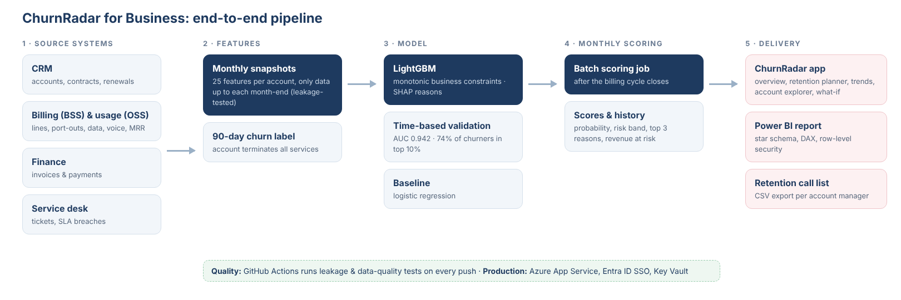
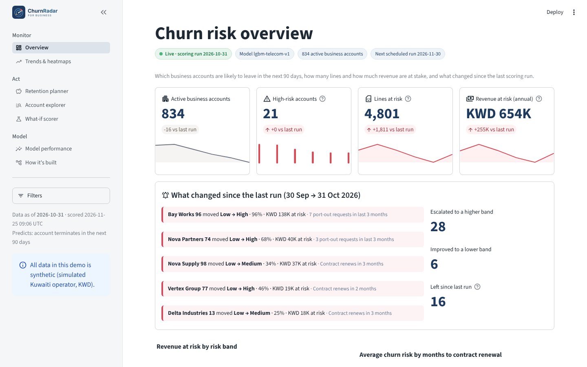
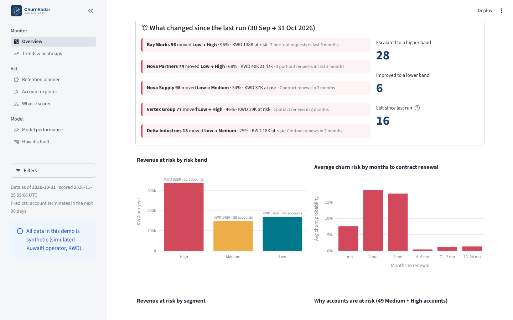
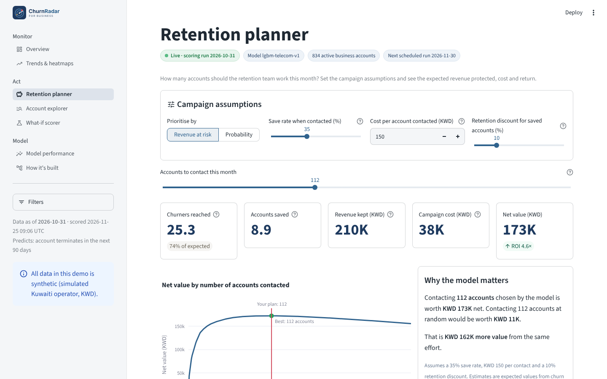
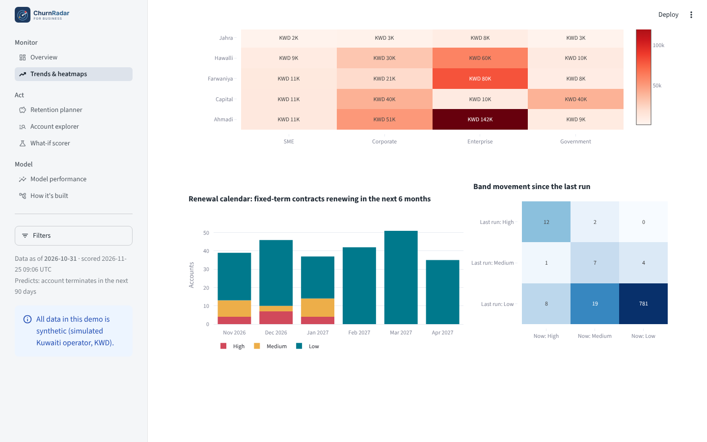
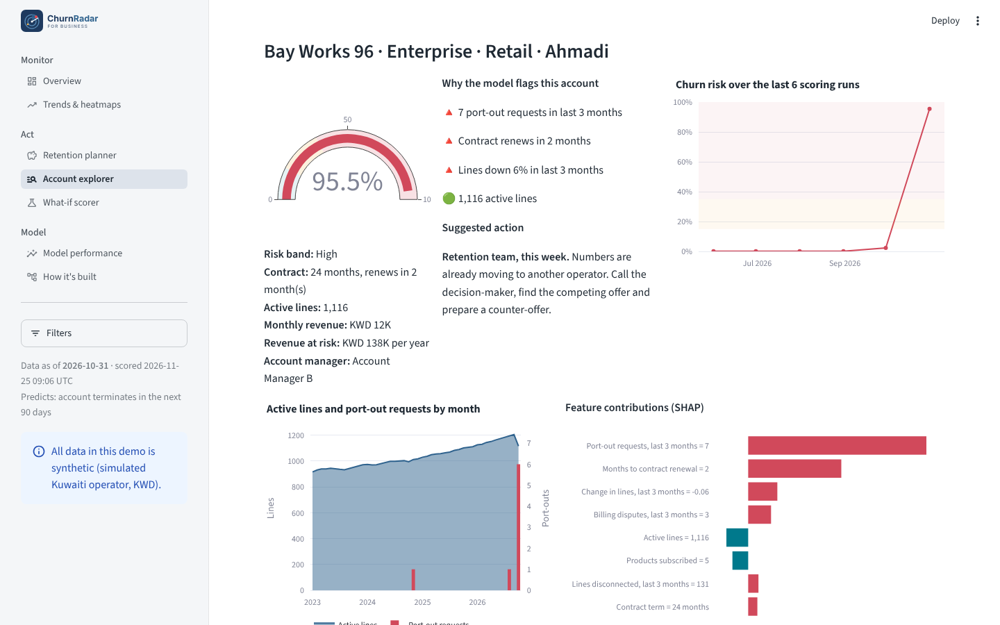
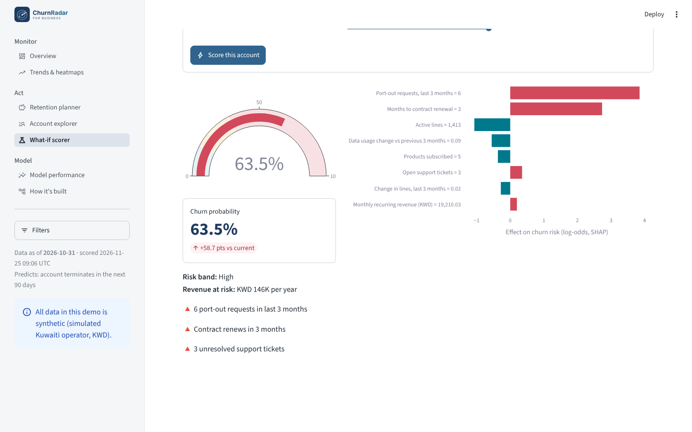
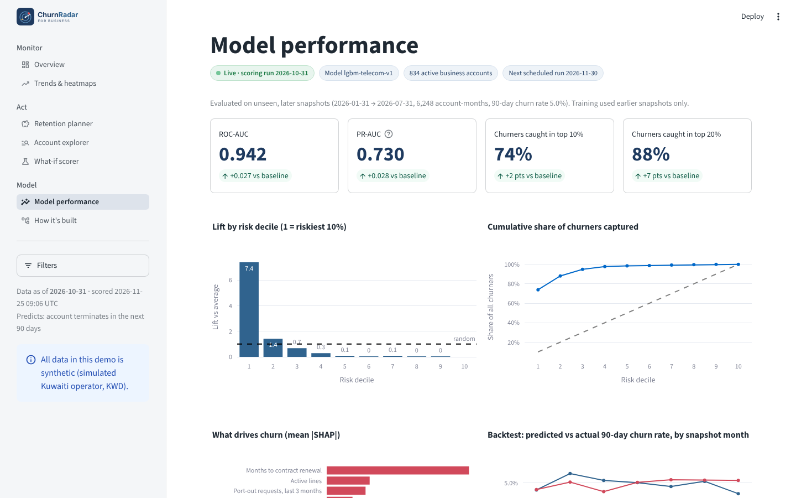

# B2B Telecom Churn Prediction: end to end

Predicts which **business (B2B) telecom accounts** will **terminate their services in the next 90 days**,
explains **why** for every account, and delivers the results to account managers and the retention team
through **ChurnRadar for Business**, a Streamlit app, and a **Power BI report**. The app also plans the
retention campaign: how many accounts to call this month, and what that is worth.

> **Live demo:** `https://<your-app>.streamlit.app` · **All data is synthetic.** The project is based on a real
> business problem. The data simulates a Kuwaiti telecom operator's business unit (amounts in KWD, regions are
> Kuwait's governorates); no real operator, customer or employee data is used.

## Business problem

A telecom operator's business unit sells mobile lines, fixed broadband, cloud, IoT and SIP trunking to companies
on 12-month, 24-month and month-to-month contracts. When a business customer leaves, the operator loses hundreds
or thousands of lines at once, usually to a competitor at contract renewal. By the time the termination request
arrives, it is too late to make a counter-offer.

**Goal:** give account managers a ranked, explained list of at-risk accounts **2–3 months before renewal**, while
there is still time to act.

## Results (on later, unseen months)

| Metric | Logistic regression (baseline) | **LightGBM** |
|---|---|---|
| ROC-AUC | 0.915 | **0.942** |
| PR-AUC (random = 0.050) | 0.702 | **0.730** |
| Churners caught in riskiest 10% | 72% | **74%** |
| Churners caught in riskiest 20% | 81% | **88%** |

**In business terms:**
- Working the riskiest 10% of accounts reaches **74% of all accounts that will leave**, **7.4× better than random**.
- The current scoring run flags **21 high-risk and 28 medium-risk accounts**, with **4,800 lines** and
  **KWD 654K of annual revenue at risk** across 834 active business accounts.

LightGBM beats the logistic regression baseline on every metric, most clearly in the riskiest 20% (88% vs 81% of
churners caught). It was kept for that and because it gives per-account SHAP explanations.

**Business-logic constraints.** The model uses *monotonic constraints*: more port-outs, complaints, billing disputes,
SLA breaches or late payments can only **increase** risk, and falling lines or usage can only increase it too.
Without them, confounders (large accounts log more tickets; regional outages create complaints in healthy accounts)
made some complaints look *protective*, which no account manager would trust. Accuracy stayed the same.

### What drives churn
1. **Contract renewal timing:** risk is concentrated in the 3 months before renewal
2. **Port-out requests:** numbers moving to another operator, usually 2–4 months before the account leaves
3. **Account size:** smaller accounts (fewer lines, lower MRR) churn more
4. **Falling data usage and lines** compared with the previous quarter
5. **Tenure, contract and segment:** newer accounts, month-to-month contracts and SMEs churn more; hospitality and
   logistics are the riskiest industries, and Jahra and Farwaniya churn more than Capital and Hawalli

## How it works



**1. Churn definition.** An active business account (billed this month) has *churned* if it **terminates all
services within the next 90 days**.

**2. Snapshots, not a single table.** Features are built at every month-end from Jan 2024 to Jul 2026, using
**only data available on that date**. The CRM `status` and `termination_date` are used only to build the label.
A unit test (`tests/test_features.py`) proves there is no leakage by rebuilding features with all future data
removed and checking they are identical.

**3. Features (25).**

| Group | Features |
|---|---|
| Contract | months to renewal, contract term, tenure |
| Lines | active lines, % change in lines, lines disconnected, **port-out requests** |
| Revenue & usage | MRR and its trend, data per line, data and voice usage trends, products subscribed and dropped |
| Service | tickets, network/data-speed complaints, billing disputes, SLA breaches, open tickets, resolution time |
| Payments | average days paid late, overdue amount |
| Account | segment (SME / Corporate / Enterprise / Government), industry, region |

**4. Time-based validation.** Train on 2024-01 → 2025-10, test on 2026-01 → 2026-07, with a 90-day gap so no
training label overlaps the test period. Random splits would overstate performance.

**5. Explainability.** LightGBM's built-in TreeSHAP gives each account its top 3 risk reasons in plain language,
for example *"12 port-out requests in last 3 months"*, *"Contract renews in 2 months"* or *"Data usage down 34% vs
previous quarter"*, plus a suggested next action for the account manager.

**6. Monthly scoring with history.** `src/score.py` scores every active account and keeps the last six monthly
runs, so the app can show trends and "what changed since the last run" alerts.

## The app: ChurnRadar for Business

| Section | Page | What it does |
|---|---|---|
| Monitor | **Overview** | KPIs with month-over-month change and 6-run sparklines, "what changed since the last run" alerts, revenue at risk by band and segment, risk by months to renewal, top reasons, top 15 accounts |
| Monitor | **Trends & heatmaps** | Risk across the last 6 monthly scoring runs, governorate × segment heatmap, 6-month renewal calendar, band movement since last run |
| Act | **Retention planner** | ROI simulator: set save rate, contact cost and retention discount; finds the best number of accounts to call, compares model-ranked vs random targeting, exports the call list |
| Act | **Account explorer** | Search and filter the risk list; per-account gauge, reasons, suggested action, risk history, lines and port-outs trend, SHAP chart |
| Act | **What-if scorer** | Change an account's situation (port-outs, renewal date, complaints, usage) and see the risk update |
| Model | **Model performance** | Lift, cumulative gains, SHAP importance, monthly backtest, baseline comparison |
| Model | **How it's built** | Pipeline status, data sources, architecture, demo vs production design |



**What changed since the last run.** Each monthly scoring run is compared with the previous one, so the team
sees new high-risk accounts first:



**Retention planner.** With a 35% save rate, KWD 150 per contact and a 10% retention discount, contacting the
**112 accounts** the model ranks highest is worth about **KWD 173K net** (ROI 4.6×). The same effort on 112
random accounts is worth about KWD 11K.



| Trends & heatmaps | Account explorer |
|---|---|
|  |  |

| What-if scorer | Model performance |
|---|---|
|  |  |

## Quick start

```bash
git clone https://github.com/Parkar05/telecom-churn-prediction.git
cd telecom-churn-prediction
python -m venv .venv
.venv\Scripts\activate            # macOS/Linux: source .venv/bin/activate
pip install -r requirements-dev.txt

python run_pipeline.py            # generate data -> train -> score
streamlit run app.py              # open http://localhost:8501
pytest -q                         # leakage and data-quality tests
```

To explore the modelling step by step, open `notebooks/churn_modeling.ipynb`.

## Deploying the demo (Streamlit Community Cloud, free)

1. Push this repo to GitHub. The `artifacts/` folder is committed, so the app needs no raw data.
2. Go to [share.streamlit.io](https://share.streamlit.io) → **Create app** → choose the repo, branch `main` and
   main file `app.py`.
3. Under **Advanced settings**, pick Python 3.13. Deploy, then paste the URL at the top of this README.

The `Dockerfile` runs the same app on any container platform.

## Production design

| | Demo | Production |
|---|---|---|
| Data | Synthetic CSV files | Read-only views on CRM, billing (BSS), usage (OSS) and service-desk data |
| Hosting | Streamlit Community Cloud | Azure App Service or Container Apps (this Dockerfile), private network |
| Access | Public link | Entra ID single sign-on; each account manager sees only their accounts (RLS) |
| Scoring | Run manually | Monthly job after the billing cycle closes; scores written to SQL or a lakehouse |
| Secrets | None needed | Azure Key Vault, never in code or Git |
| Monitoring | Backtest page | Monthly predicted-vs-actual check, feature drift, quarterly retraining |
| Privacy | No personal data | Account-level behavioural features only; contact names and numbers stay in source systems (Kuwait CITRA data-privacy regulation) |

## Project structure

```
├── app.py                     ChurnRadar Streamlit app (7 pages)
├── assets/                    Logo and icon
├── run_pipeline.py            Runs data -> train -> score
├── src/
│   ├── config.py              Churn definition, dates, risk bands
│   ├── generate_data.py       Synthetic B2B telecom simulator
│   ├── features.py            Leakage-safe snapshot features + labels
│   ├── train.py               Baseline vs LightGBM, metrics, lift, SHAP importance
│   ├── score.py               Monthly batch scoring, score history, Power BI tables
│   └── model_utils.py         Shared helpers: SHAP reasons, risk bands
├── notebooks/churn_modeling.ipynb   EDA, modelling, evaluation, SHAP
├── artifacts/                 Model, scores and evaluation outputs used by the app
├── powerbi/                   Star-schema CSVs + POWERBI_GUIDE.md with DAX
├── tests/                     Leakage and data-quality tests
├── docs/                      Banner, architecture diagram, screenshots
├── Dockerfile                 Container for Azure / internal hosting
└── .github/workflows/ci.yml   Runs tests on every push
```

## Limitations and next steps

- The data is simulated, so real-world performance would differ. The method transfers; the numbers don't.
- Risk-band thresholds (15% / 35%) should be agreed with the retention team based on their monthly capacity.
- Next: predict **partial churn** (large drops in lines without full termination), add NPS and competitor-offer
  signals and per-site network KPIs, and measure business impact with a control group of flagged accounts that
  are not contacted.

---
*Built with Python, pandas, LightGBM, SHAP, Streamlit, Plotly and Power BI.*
